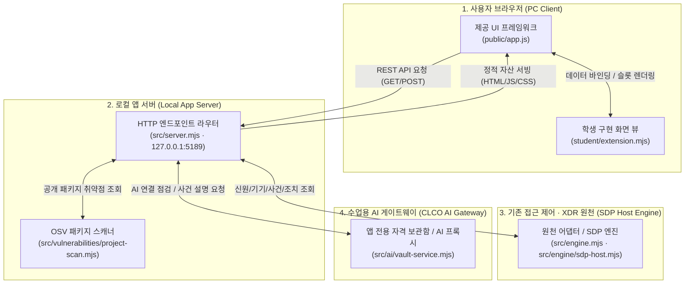

# 보안 Agent ‘케셰브’ 학생용 실행 설명서 및 시스템 구성도 (STUDENT_RUNBOOK.md)

이 문서는 보안 Agent ‘케셰브’ 프로젝트를 다른 개발자 또는 평가자가 임의의 새로운 작업 환경에서 설치, 실행, 구성 대조, 문제 해결을 수행할 수 있도록 작성된 독립 실행 설명서입니다.

---

## 1. 실행 환경 및 사전 요구사항

* **운영체제(OS)**: Windows 10 / 11, Linux, macOS (PowerShell 또는 POSIX 호환 셸)
* **런타임 및 엔진**:
  * **Node.js**: `v24.19.0` (지원 범위: Node.js 22 ~ 24, 외부 npm 의존성 없음)
  * **Git**: `2.56.0` 이상
* **이동 가능한 경로 원칙**:
  * 특정 사용자의 절대 경로(`C:\Users\...`)에 의존하지 않으며, 모든 실행 명령은 프로젝트 루트 상대 경로(`.`)를 기준으로 동작합니다.
* **보안 및 비밀값 격리 준수**:
  * API 키, 사용자 비밀번호, 인증 토큰, 세션 쿠키 등의 민감 정보는 문서 및 코드에 일절 기재하지 않습니다.
  * 환경 설정 파일(`.env`)은 저장소 제출 대상에서 제외되며 `.env.example` 템플릿만 제공됩니다.

---

## 2. 프로젝트 폴더 구조

```text
onclient/
├── docs/                        # 공통 과제 안내, 프롬프트, 커리큘럼 및 학생 문서
│   ├── CURRICULUM.json          # 단계별 평가 항목 및 세부 계약
│   ├── STUDENT_PROMPTS.md       # 13~22단계 상세 안내 프롬프트
│   ├── STUDENT_RUNBOOK.md       # [본 문서] 학생용 실행 설명서 및 시스템 구성도
│   └── RELEASE_REPRODUCTION.md  # 최종 릴리스 및 새 환경 재현 기록서
├── public/                      # 제공 웹 화면 정적 파일 (수정 금지)
│   ├── index.html               # 단일 페이지 애플리케이션 진입점
│   ├── app.js                   # 화면 제어 및 상태 머신 로직
│   └── style.css                # 공통 스타일시트
├── src/                         # 로컬 앱 서버 및 백엔드 어댑터 (수정 금지)
│   ├── server.mjs               # Node.js 내장 http 기반 로컬 서버
│   ├── engine.mjs               # 기존 접근 제어/기기 어댑터 연결 모듈
│   └── vulnerabilities/         # OSV 프로젝트 스캔 모듈
├── student/                     # [학생 구현 영역]
│   └── extension.mjs            # 단계별 학생 뷰 렌더러 함수 모음 (createStudentView)
├── tools/                       # 실행 보조 스크립트
├── .env.example                 # 비밀 없는 기본 환경 설정 템플릿
├── package.json                 # 실행 스크립트 및 Node 엔진 정의
└── README.md                    # 프로젝트 기본 소개 및 안내
```

---

## 3. 설치 및 실행 절차 (이동 가능한 상대 경로 기준)

### 3.1. 셸 열기 및 프로젝트 위치 이동
PowerShell 또는 Bash 셸을 열고 프로젝트 최상위 디렉터리로 이동합니다.
```powershell
# 프로젝트 루트 디렉터리로 이동 (상대 경로 예시)
cd ./onclient
```

### 3.2. 환경 설정 파일 준비 (.env.example 기반)
필요 시 `.env.example` 파일을 복사하여 로컬 실행 설정(`.env`)을 생성합니다 (별도 수정 없이 기본값으로 동작 가능).
```powershell
Copy-Item .env.example .env
```
* **기본 설정 내용**:
  * `ON_PORT=5189`: 로컬 서버 포트
  * `ON_ENGINE_ADAPTER=./student/engine-adapter.mjs`: 기본 어댑터 경로
  * `ON_AI_MODEL=aleph/auto`: AI 모델 정책
  * `ON_PROJECT_DIRECTORY=`: 프로젝트 대상 디렉터리
  * `ON_APPROVED_PUBLIC_PACKAGES=[]`: OSV 공개 조회 승인 패키지 목록

### 3.3. 문법 및 정적 무결성 검사
학생 구현 파일의 문법적 오류가 없는지 검사합니다.
```powershell
npm run check
# 또는: node --check student/extension.mjs
```
* **정상 결과**: 오류 메시지 없이 종료 코드 `0`으로 완료됩니다.

### 3.4. 서버 실행 명령
서버 실행은 아래 명령 중 하나를 사용할 수 있습니다.

1. **표준 로컬 연결 모드 실행**:
   ```powershell
   npm start
   # 또는: node src/server.mjs
   ```
   * **정상 시작 신호**:
     콘솔에 아래 문구가 출력됩니다:
     ```text
     케셰브 연결 확인: http://127.0.0.1:5189
     ```

2. **예제 자료(Demo) 모드 실행**:
   ```powershell
   npm run demo
   # 또는: node src/server.mjs --demo
   ```
   * **정상 시작 신호**:
     콘솔에 `케셰브 예제: http://127.0.0.1:5189` 가 출력됩니다.

### 3.5. 브라우저 접속
웹 브라우저를 열고 로컬 서버 주소로 접속합니다.
* **접속 주소**: `http://127.0.0.1:5189`

### 3.6. 서버 종료 및 재실행
* **서버 종료**: 서버가 실행 중인 콘솔에서 `Ctrl + C`를 누르고, 작업 종료 여부 프롬프트 시 `Y`를 입력합니다.
* **재실행**: 종료 후 다시 `npm start` 또는 `npm run demo`를 입력합니다.

---

## 4. 시스템 구성도 (System Architecture)

### 4.1. 텍스트 및 모듈/주소 대응 표
전체 시스템은 4개 영역으로 명확히 구분되며, 각 구성 요소의 물리적 파일과 주소는 다음과 같습니다:

| 구성 요소 | 역할 | 실제 파일 경로 또는 주소 | 통신 방식 / 비고 |
|---|---|---|---|
| **브라우저 (사용자 UI)** | 제공 UI와 학생 UI 슬롯이 렌더링되는 SPA 웹 인터페이스 | `public/index.html`, `public/app.js`, `student/extension.mjs` | 브라우저 DOM API (`createElement`, `textContent`) |
| **로컬 앱 서버** | 요청 중계, 정적 파일 서빙, 로컬 진단, 토큰 격리 | `src/server.mjs` (Listen: `127.0.0.1:5189`) | Node.js native `http` 모듈 (loopback 전용) |
| **접근 제어·기기·XDR 원천** | 사용자 신원, 기기 규정 준수, 판정, 보안 기록 제공 | `src/engine.mjs`, `src/engine/sdp-host.mjs`, 어댑터 | `/api/me`, `/api/apps`, `/api/access`, `/api/events` |
| **수업용 AI (알레프게이트/CLCO)** | 보안 사건 분석, 근거 대조 설명 제공 | `src/ai/service.mjs`, 원격 AI 게이트웨이 엔드포인트 | `/api/ai/check`, `/api/ai/explain` (서버 전용 자격) |

### 4.2. Mermaid 다이어그램



---

## 5. 제공 코드와 학생 구현 영역 경계 (Boundary)

| 함수 / 영역 | 담당 파일 | 제공 / 학생 구분 | 상세 설명 및 역할 |
|---|---|---|---|
| **기본 쉘 / 제어기** | `public/app.js`, `public/index.html` | 제공 코드 | 전체 메뉴 네비게이션, 네트워크 통신(`request`), 학생 슬롯 렌더링 호출, 확인 티켓 제어 |
| **`renderIdentity`** | `student/extension.mjs` | **학생 구현 (13단계)** | 로그인 사용자, 기기 보안 상태(충족/미충족), 세션 상태(활성/만료/철회)를 한글 라벨과 원본 값으로 표시 |
| **`renderDecision`** | `student/extension.mjs` | **학생 구현 (14단계)** | 업무 앱 접속 판정(허용/거부/추가확인) 및 사유·시각 표시, 오류 발생 시 접근 허용으로 오인하지 않도록 안내 |
| **`renderEvents`** | `student/extension.mjs` | **학생 구현 (15, 16단계)** | 접속 및 XDR 보안 기록 최신순 정렬, 다중 필터링, 사건 상세(근거/규칙/상태), 미지원 조치 비활성 버튼 표시 |
| **`renderStatus`** | `student/extension.mjs` | **학생 구현 (16단계)** | 기기·세션·진단 정보·알림의 로딩/빈목록/오류 구분 표시, 안전한 6개 진단 필드 노출 및 `도움정보 복사` 버튼 제공 |
| **`renderAiConnection`** | `student/extension.mjs` | **학생 구현 (17단계)** | AI 연결 상태(idle/loading/ok/error) 표시, `test`/`verified` 구분, 사용 가능 모델 수 안내, 사건 설명 미실행 상태 명시 |
| **`renderExplanation`** | `student/extension.mjs` | **학생 구현 (17, 18단계)** | 선택한 사건의 근거(`evidenceIds`), 적용 규칙(`rules`), `unknown` 상태, 제안(proposals) 및 미실행 상태 대조 표시 |
| **`renderAction`** | `student/extension.mjs` | **학생 구현 (19단계)** | 조치 상태(idle/loading/prepared/executing/pending/succeeded/denied/failed/unknown/expired/error) 구분, ACK ≠ 완료 명시, `effectApplied: true` 확인 시에만 실제 효과 성공 표시 |
| **`renderVulnerabilities`** | `student/extension.mjs` | **학생 구현 (20단계)** | `package-lock.json` lockfileVersion/Hash 대조, 정확한 패키지 버전 및 OSV 취약점 ID/수정시각 표시, 미조회/실패 구분 |

---

## 6. 장애 상황 및 문제 해결 가이드 (Failure & Troubleshooting)

화면에 표시되는 주요 상태 및 오류 문구별 원인과 대응 방법입니다:

| 화면 표시 문구 / 상태 | 원인 분석 | 확인 및 복구 방법 |
|---|---|---|
| **`서버에 연결하지 못했습니다.`** / **`연결 없음`** | 로컬 백엔드 서버가 구동되지 않았거나 포트(`5189`) 충돌 발생 | 1) 콘솔에서 `npm start`가 정상 실행 중인지 확인<br>2) 다른 프로세스가 5189 포트를 점유하고 있지 않은지 확인 |
| **`기기 목록을 불러오지 못했습니다: 요청 처리 시간이 초과되었습니다.`** | 원천 어댑터 응답 지연 (`ENGINE_TIMEOUT`, `REQUEST_TIMEOUT`) | 1) 자동 재시도가 발생하지 않으므로 상단 ‘다시 불러오기’ 버튼을 직접 클릭<br>2) 네트워크 및 로컬 루프백 상태 확인 |
| **`AI 연결 점검 실패 [ON_AI_PROVISIONING_PENDING]`** | 학생 계정 전용 AI 권한이 서버 또는 게이트웨이에서 준비 중인 상태 | 학생 코드 결함이 아니며 운영자/담당자에게 AI 이용 권한 프로비저닝 상태 확인 요청 |
| **`AI 연결 점검 실패 [WB_CLCO_AUTH_REQUIRED]`** | 앱 전용 인증 자격이 유효하지 않거나 미등록 상태 | 1) 보호 현황 계정 연결 재수행<br>2) Workbench 원본 열쇠를 임의 복사하지 말고 전용 발급 절차 확인 |
| **`AI 연결 점검 실패 [WB_CLCO_RATE_LIMITED]`** | 단시간 내 AI 점검 요청 과다 호출 | 잠시 대기 후 사용자가 직접 점검 버튼 클릭 (자동 재요청 금지) |
| **`AI 설명 수용 불가: 근거가 맞지 않음`** | AI가 반환한 `evidenceIds`가 실제 사건의 `event.evidence`에 부합하지 않음 | 임의로 근거를 지어내지 않고 설명을 거절하며, 다른 정상 사건을 선택해 재요청 |
| **`조치 상태: 결과 불명(unknown)`** | 서버 응답은 수신되었으나 실제 원천 조치 효과(`effectApplied: true`)가 미확인됨 | 성공이나 효과 없음으로 단정하지 않고 제공 화면의 결과 재조회 기능 사용 |
| **`전체 조회 상태: 조회 준비 미완료(not_configured)`** | 프로젝트 대상 경로 또는 허용된 패키지 목록 설정이 비어 있음 | 대상 패키지 승인 목록 및 프로젝트 설정 상태 확인 (조회 실패가 아니며 취약점 없음으로 오인 금지) |

---

## 7. 실제 지원 범위 및 미확인(UNV) 항목 명시

* **실제 확인 완료된 기능 (Verified)**:
  * 로컬 Node.js 서버(`src/server.mjs`) 구동 및 loopback(`127.0.0.1:5189`) 응답
  * `student/extension.mjs`의 모든 렌더링 함수(`renderIdentity` ~ `renderVulnerabilities`)에 대한 단위 테스트 및 구문 무결성 통과
  * DOM API (`createElement`, `textContent`) 및 키보드 접근성 유지
  * 상태별 문구 분리(오류, 로딩, 빈 목록, 성공, 확인 불가 구분)
  * 진단 정보 복사 버튼 클릭 시 민감 정보(비밀번호, 토큰, API 키) 배제 검증
* **기다림 / 미확인 항목 (UNV - Unverified)**:
  * **실제 운영 SDP 원천 실서버 연동**: 실제 원격 기업 인프라와의 실시간 SDP 자격 증명 연동은 실운영 환경이 준비되지 않아 로컬 모의 및 어댑터 레벨 검증으로 제한됨.
  * **실제 원천 조치 집행기 연결**: 실제 엔드포인트 기기 격리/차단 집행은 운영자 권한과 전용 에이전트 인프라가 필요하므로 본 클라이언트에서는 화면 계약(ACK와 효과 분리)까지만 구현·검증됨.
  * **유료 상용 AI 모델 직접 호출**: 과제 평가 비용 및 자격 보호를 위해 실제 외부 유료 LLM에 대한 직접 API 호출은 수행하지 않음.
